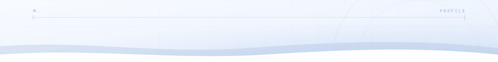
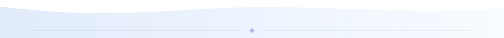

<picture>
  <source media="(prefers-color-scheme: dark)" srcset="icons/header-dark.svg">
  
</picture>

<h1>Mirko</h1>

<picture>
  <source media="(prefers-color-scheme: dark) and (max-width: 600px)" srcset="https://readme-typing-svg.demolab.com?font=JetBrains+Mono&weight=500&size=13&pause=900&color=7C9CFF&center=true&vCenter=true&width=340&lines=software%20%C2%B7%20networks%20%C2%B7%20systems&repeat=false">
  <source media="(max-width: 600px)" srcset="https://readme-typing-svg.demolab.com?font=JetBrains+Mono&weight=500&size=13&pause=900&color=3B5BDB&center=true&vCenter=true&width=340&lines=software%20%C2%B7%20networks%20%C2%B7%20systems&repeat=false">
  <source media="(prefers-color-scheme: dark)" srcset="https://readme-typing-svg.demolab.com?font=JetBrains+Mono&weight=500&size=16&pause=900&color=7C9CFF&center=true&vCenter=true&width=520&lines=software%20%C2%B7%20networks%20%C2%B7%20systems&repeat=false">
  
</picture>

  <a href="#about"><samp>about</samp></a> &nbsp;·&nbsp;
  <a href="#stack"><samp>stack</samp></a> &nbsp;·&nbsp;
  <a href="#projects"><samp>projects</samp></a> &nbsp;·&nbsp;
  <a href="#contact"><samp>contact</samp></a>

<h3 id="about" align="center"><samp>about</samp></h3>

<picture>
  <source media="(prefers-color-scheme: dark)" srcset="icons/divider-dark.svg">
  
</picture>

  <i>“Whoever wishes to foresee the future must consult the past; 
  for human events ever resemble those of preceding times.”</i> 
  — Niccolò Machiavelli, <i>Discourses on Livy</i>

<h3 id="stack" align="center"><samp>stack</samp></h3>

<picture>
  <source media="(prefers-color-scheme: dark)" srcset="icons/divider-dark.svg">
  
</picture>

  <samp>languages</samp> 
   
  

  <samp>frameworks, data &amp; tools</samp> 
  

<h3 id="projects" align="center"><samp>projects</samp></h3>

<picture>
  <source media="(prefers-color-scheme: dark)" srcset="icons/divider-dark.svg">
  
</picture>

<samp>selected work</samp>

<picture>
  <source media="(prefers-color-scheme: dark)" srcset="icons/blance-dark.svg">
  
</picture>

<h3 align="center">B-Lance</h3>

  Split expenses, not friendships. 
  Android + web · 125 currencies · fewest transfers

<samp>Flutter · FastAPI · SQLite / PostgreSQL · Vercel</samp>

<a href="https://github.com/mirkosio/b-lance"><samp>repository →</samp></a>

<h3 id="contact" align="center"><samp>contact</samp></h3>

<picture>
  <source media="(prefers-color-scheme: dark)" srcset="icons/divider-dark.svg">
  
</picture>

<samp>write me</samp>

  
  &nbsp;&nbsp;
  
  &nbsp;&nbsp;
  

<picture>
  <source media="(prefers-color-scheme: dark)" srcset="icons/footer-dark.svg">
  
</picture>
